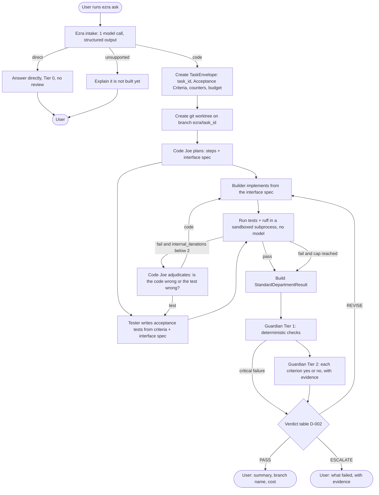

# Phase 1: Thin Working Slice

**Goal:** one real coding request flows end to end: **User → Ezra → Code Joe (Builder + Tester) → Guardian → User**. Every model call is logged, and every step lands in a trace we can read in Phase 2.
**Governed by:** [decisions.md](decisions.md) (D-001 to D-010).
**Status:** Plan, awaiting approval. Nothing is built yet.

---

## 1. What's in and what's out

| In Phase 1 | Deferred |
|------------|----------|
| CLI (`ezra ask`, `ezra chat`, `ezra trace`) | Web or voice interface |
| Ezra intake: route the request, write Acceptance Criteria, answer simple questions directly | Standards library, user profile, context retrieval (Phase 3) |
| Model Gateway: one entry point for every model call, with token, cost and latency logging and budget limits | Model Registry, Model Evals, dynamic router (Phase 6) |
| Code Joe as a LangGraph graph: plan → Builder and Tester → run → adjudicate → iterate | Code Joe on non-Python projects |
| Guardian Tier 1 (deterministic) and Tier 2 (checklist), the D-002 verdict table, the D-004 counters | Tier 3 full rubric, earned trust, offline scoring |
| SQLite store and readable traces | Postgres, object storage |
| Approval matrix: only the parts this slice can trigger (cost limits; code never leaves its branch) | The rest of D-009 (no external actions exist yet) |
| | Learner (Phase 4), Artifact Creator (Phase 5) |

**Why we build the loop ourselves (Messages API + LangGraph) instead of Anthropic's hosted Managed Agents:** LangGraph is a locked decision, everything runs locally, and the point is to learn how orchestration works by owning it. Managed Agents would host the loop for us, but would hide exactly the parts we want to understand.

---

## 2. How a request flows



`HOLD` isn't shown here because it can happen at *any* model call, not only at review (see section 4, Cost limits).

### Three design choices worth understanding

**1. A shared interface spec.** Code Joe's plan includes an interface spec: which files, functions and signatures will exist. Builder and Tester both receive it. Without it, Tester has to guess names and iterations get wasted on naming mismatches instead of real bugs.

**2. Tester independence.** Tester writes acceptance tests from the Acceptance Criteria and the interface spec, *without seeing Builder's code*. That keeps tests from simply confirming whatever Builder happened to write.
- Builder **cannot write to Tester's test files**; the path guard rejects it. Otherwise Builder could "pass" by weakening the tests.
- When tests fail, Code Joe **adjudicates**: either the code is wrong (back to Builder) or the test is wrong (back to Tester). Both count as internal iterations.

**3. REVISE goes to Builder, and the tests are frozen.** After Guardian says `REVISE`, Builder gets Guardian's repair instructions and fixes the code. The plan and the tests are *not* regenerated, so the goalposts can't move between attempts. Builder then gets **one** more run → test cycle (D-004).

---

## 3. Model routing table (fixed for Phase 1)

This table stands in for the Model Router until Model Evals exist (Phase 6). The picks come from your routing dataset and your rule that Code Joe runs on a stronger model than Builder and Tester.

| Operation | Model | Effort | Why |
|-----------|-------|--------|-----|
| `ezra.intake` (route, criteria, direct answers) | `claude-sonnet-5-5` | medium | General assistant work (dataset T09); one call does all three |
| `code_joe.plan` | `claude-opus-5-5` | medium | Ambiguous multi-file coding (T17); must be above Builder |
| `code_joe.adjudicate` | `claude-opus-5-5` | low | Short judgement call: is the test or the code at fault? |
| `builder.implement` | `claude-sonnet-5-5` | medium | Well-scoped coding (T16) |
| `tester.write_tests` | `claude-sonnet-5-5` | medium | Test generation |
| `guardian.tier2` | `claude-opus-5-5` | low | Code review (T21). A different model from Builder, so their blind spots are less likely to line up |

It lives in `config/routing.yaml`, so changing a model means editing config, not code.

**Gateway behavior on every call:**
- Adaptive thinking.
- Effort taken from the table.
- Prompt caching on static system prompts. Cache-read tokens are logged from M2 on, so we *measure* the savings. Short prompts may fall under the cache minimum, so none are assumed.
- Server-side refusal fallbacks turned on.
- Bounded infrastructure retries.
- One `ModelInvocation` row per call (the schema from the routing addendum §11).

---

## 4. Safety rails in the slice

| Rail | How it's enforced |
|------|-------------------|
| **Code Joe only touches its own copy** | Every task gets a fresh git worktree on branch `ezra/<task_id>`. The file tools resolve real paths (so symlinks can't escape) and reject anything outside the worktree. Builder is also blocked from Tester's test files. |
| **No arbitrary shell for the models** | Builder and Tester get file tools only (read, list, write, edit). They can't run commands. |
| **Running tests is sandboxed, not airtight** | `pytest` and `ruff` run as a subprocess with cwd set to the worktree, a **scrubbed environment** (no `ANTHROPIC_API_KEY` or other secrets), and a timeout. **Residual risk:** running the tests means running Builder's code with your user's file permissions. In Phase 1 that's acceptable, because tasks target the `playground/` repo and you review the code before merging. A container sandbox is a later hardening step. |
| **Code never leaves its branch** | Phase 1 has no push or merge code at all. At PASS, Ezra reports the branch name and the diff summary; *you* merge if you want it (D-009 Level 1). That's also why Guardian Tier 3 (D-007, "code going to main") isn't needed yet. |
| **Cost limits** | Before each call, the Gateway checks: *actual spend so far + the worst case for this call* (counted input tokens + `max_tokens` × output price). If that would pass **$2** for the task or **$10** for the day, the task pauses with `HOLD` and Ezra asks you. LangGraph's interrupt + SQLite checkpointer should let the graph pause at any node and resume after your answer; **this is verified at M4**, and if it doesn't hold, the fallback is to end the task cleanly with a resumable checkpoint. |
| **Loop limits** | `infra_retries` ≤ 2 per call. `internal_iterations` ≤ 2 before the first submission and ≤ 1 after a REVISE. `correction_cycles` ≤ 1 per task. All of them are held in the TaskEnvelope. |
| **Secrets** | The API key comes from your environment or `ant auth login`. It is never written to the database, the traces or the test subprocess. |

---

## 5. Contracts (the core shapes)

- **AcceptanceCriterion:**
  - `id`
  - `text`
  - `severity`: `critical`, `major` or `minor` (D-001)
  - `verification`: `test` (checked by a test), `inspection` (checked by Guardian reading the diff) or `deterministic` (checked by code, e.g. "ruff passes")
  - `required_evidence`
- **TaskEnvelope:** the spec's §9.1 fields, plus the Acceptance Criteria snapshot, the three D-004 counters and the budget.
- **StandardDepartmentResult:** the spec's §9.2 fields, plus the interface spec, changed files, test results and the worktree branch.
- **GuardianReview:**
  - the spec's §8.5 fields
  - `tier`
  - per-criterion result (`met`, `unmet` or `cannot_verify`) with evidence
  - verdict
- **ModelInvocation:** the routing addendum's §11 record, plus cache-read tokens.

---

## 6. Repository layout

`Ezra A.I.` becomes its own git repo. **`playground/` is a separate git repo** nested inside it but ignored by Ezra's repo, so Code Joe's worktrees are of the playground, never of Ezra itself. Runtime data stays out of version control.

```
Ezra A.I./                   ← git repo (Ezra's own code)
├── .gitignore               playground/, .ezra/, .venv/
├── docs/                    decisions.md, phase-1-plan.md
├── pyproject.toml
├── config/
│   ├── routing.yaml         operation → model + effort
│   └── limits.yaml          budgets, loop caps, test timeout
├── src/ezra/
│   ├── cli.py               ezra ask | chat | trace
│   ├── contracts.py         Pydantic models from section 5
│   ├── intake.py            Ezra intake
│   ├── gateway.py           the only place that calls Claude
│   ├── store.py             SQLite: tasks, invocations, results, reviews, events
│   ├── code_joe/
│   │   ├── graph.py         LangGraph graph + state
│   │   ├── builder.py
│   │   ├── tester.py        test writing + sandboxed test run
│   │   └── workspace.py     worktrees + path guard
│   └── guardian/
│       ├── tier1.py         deterministic checks
│       ├── tier2.py         checklist review
│       └── verdict.py       the D-002 table as pure code
├── tests/                   Ezra's own unit tests
├── .ezra/                   (ignored) ezra.db, worktrees/
└── playground/              (ignored, own git repo) demo project for Code Joe
```

---

## 7. Build steps

The steps are ordered so everything that needs **no API access** comes first. We can start before your credentials are set up.

| # | Step | Needs API? | Done when |
|---|------|-----------|-----------|
| M1 | **Foundation:** git init, pyproject, contracts, SQLite store, `verdict.py`, Guardian Tier 1, workspace + path guard, `playground/` repo | No | Unit tests cover every row of the D-002 table, every D-004 counter edge case, and path-guard escapes (including `..` and symlinks) |
| M2 | **Gateway + CLI:** model calls, logging, cost estimate, budget check | Yes | `ezra ask "what's 2+2"` answers, and its tokens (including cache reads) and cost are in the database |
| M3 | **Ezra intake:** structured output for route + Acceptance Criteria | Yes | A code request produces a TaskEnvelope with typed criteria; a simple question is answered directly |
| M4 | **Code Joe graph:** plan + interface spec → Builder and Tester → sandboxed run → adjudicate → iterate; budget HOLD and resume | Yes | A small task in `playground/` ends with passing tests on its own branch, and a forced budget overrun pauses and resumes |
| M5 | **Guardian Tier 2 + REVISE** | Yes | A deliberately flawed output triggers REVISE once, then PASS or ESCALATE, never a third attempt |
| M6 | **Trace viewer + first real task** | Yes | `ezra trace <task_id>` shows every step, model, token count, cost and verdict for one real task |

**Phase 1 is complete when:**
- One real coding task runs end to end under one `task_id`.
- 100% of model calls go through the Gateway and are logged.
- The file tools never write outside the worktree, which the M1 tests prove.
- Code never leaves its branch without you.
- The budget limits trigger `HOLD`.
- We have a **baseline cost and token count per successful task** to improve against.

---

## 8. Before we start

1. **API access (needed from M2).** Set `ANTHROPIC_API_KEY` in your shell profile, or install the Anthropic CLI and run `ant auth login`. Don't paste the key into chat.
2. **Python 3.14** is installed. If LangGraph doesn't support it yet, we'll see at M1 and install 3.13 alongside it.
3. **Environment:** a standard `venv` and `pip`, so nothing new to install.

---

## 9. Progress

**M1, done (2026-11-20).** 80 unit tests pass and ruff is clean. LangGraph runs on Python 3.14.

**Carried into M4:**
- Before submitting, Code Joe checks that every test-verified criterion has an acceptance test. Otherwise a missing test would REVISE back to Builder, who can't write tests, and the task would always ESCALATE.
- Worktrees live under Ezra's folder, so the sandboxed pytest and ruff runs must pass the target repo's root and config explicitly. Otherwise they could pick up Ezra's own `pyproject.toml`.
- The installed SDK is `anthropic` 2.11. Check the Python SDK docs against that version before writing the Gateway (M2).

